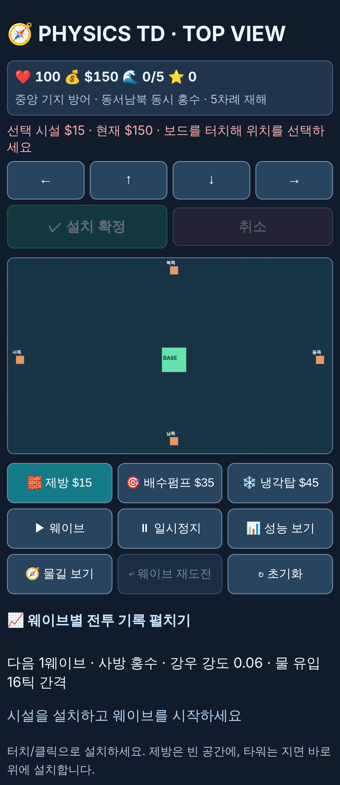

# Physics TD — 모바일 중심 전면 재구현 검토

> 작성일: 2026-11-08 · 기준 커밋: `e40b815` 이후 · 관련 문서: [설계 검토 리포트](DESIGN_REVIEW_2026-11.md), [통합 설계](PHYSICS_TD_MASTER_DESIGN.md)
> 결론부터: **부분 수정이 아니라 재구현을 권장**한다. 단, 물 시뮬레이션 수식과 테스트 자산은 유지하고, 구조·UI·입력·게임 규칙 계층을 새로 짠다. 예상 4~6주(1인 기준).

---

## 1. 현황 실측 (Playwright, 기기 에뮬레이션)

| 기기 | 뷰포트 | 셀 크기 | 보드 위치(y) | 웨이브 버튼 하단 | 메시지 위치 | 문서 높이 |
|---|---|---|---|---|---|---|
| iPhone SE | 320×568 | **7.6px** | 341–524 | 632 (화면 밖) | 812 (화면 밖) | 902 |
| iPhone 13 | 390×664 | **9.4px** | 294–519 | 화면 밖 | 화면 밖 | 897 |
| iPhone 13 가로 | 750×342 | 18.1px | 206–642 (보드가 화면보다 큼) | 756 | 924 | 997 |

### 확인된 문제
1. **터치 대상이 너무 작다.** 셀 7.6~9.4px로 권장 44px의 약 1/5. 손가락이 셀 20~30개를 덮는다 → 그래서 "방향키로 한 칸씩 미세조정"이라는 우회 UI가 생겼다(근본 해결 아님).
2. **가로형 보드(40×24)를 세로 화면에 그린다.** 보드가 화면 높이의 34%만 쓰고 나머지는 버튼·텍스트.
3. **한 화면에 게임이 안 들어온다.** 웨이브 시작 버튼·상태 메시지가 스크롤해야 보인다. 진행 중에 보드와 메시지를 동시에 볼 수 없다.
4. **조작 흐름이 위아래로 오간다.** 시설 선택(보드 아래) → 위치 터치(보드) → 확정(보드 위) → 웨이브 시작(보드 아래). 엄지 이동 거리가 크다.
5. **버튼 9개 동일 위계.** 자주 쓰는 것(시설, 시작)과 드문 것(성능, 초기화)이 같은 크기·같은 위치.
6. **상태 피드백이 텍스트뿐.** 기지 위험도·물 흐름·사거리 정보가 보드 위에 시각적으로 없다(펌프 사거리는 잘못 표시됨).
7. **가로 모드에서 보드가 화면보다 커서** 보드를 보면서 조작할 수 없다.
8. 코드 구조: 압축된 한 줄 JS, 전역 상태, DOM/캔버스/규칙 혼재, 레거시 적 시스템 잔존 → 기능 추가 비용이 크다.



---

## 2. 선택지 비교

| 안 | 내용 | 장점 | 단점 | 판단 |
|---|---|---|---|---|
| A. 점진 수정 | 현재 파일에서 CSS·레이아웃만 개선 | 빠름(3~5일) | 셀 크기 문제는 격자 구조 때문이라 해결 불가, 부채 유지 | ✗ |
| **B. 재구현 (바닐라 TS + Canvas, 모듈 구조)** | 시뮬레이션 수식 이식, 나머지 재작성 | 의존성 0, 정적 Pages 그대로, 번들 작음, 테스트 이식 쉬움 | UI 컴포넌트 직접 작성 | **✓ 권장** |
| C. 게임 엔진(Phaser/PixiJS) | 렌더링·입력·씬을 엔진에 위임 | 카메라·제스처·트윈 기본 제공 | 번들 300KB+, 시뮬은 어차피 직접 구현, 엔진 학습 비용 | △ (렌더 병목 확인 시 Pixi만 렌더러로 도입) |
| D. Godot/Unity 웹 빌드 | — | 에디터 | 웹 로딩 수 MB·모바일 브라우저 성능·Pages 부담 | ✗ |

**권장 B.** 이유: 이 게임의 핵심은 커스텀 격자 유체 시뮬레이션이고, 엔진이 대신해 줄 부분(렌더·입력)은 캔버스 + Pointer Events로 충분하다. 빌드는 `esbuild` 하나만 추가(TypeScript 타입 검사로 레거시 필드 같은 문제를 컴파일 타임에 차단).

---

## 3. 핵심 설계 결정

### 3.1 격자 이원화: 시뮬레이션 격자 ≠ 건설 격자
- **시뮬레이션 격자**: 물 표현용 세밀 격자(예: 64×96). 사용자는 직접 선택하지 않음.
- **건설 격자**: 시설 배치용 거친 격자(예: 8×12, 시뮬 8×8 셀 = 건설 1칸).
- 세로 390px 화면에서 건설 칸 = **약 46px** → 손가락으로 바로 정확히 선택 가능. 방향키 미세조정 UI 제거.
- 시설은 건설 칸 단위 점유, 효과(배수·결빙·차단)는 시뮬 격자에 적용.

### 3.2 세로(포트레이트) 우선 맵
- 맵 비율을 화면에 맞춰 **세로형(예: 2:3)** 으로 설계. 가로 모드는 보드 옆 패널 레이아웃으로 대응.
- 4방향 유입은 유지하되, 맵마다 유입 방향·수를 데이터로 정의(상류 2곳 + 강우 등).
- 큰 맵은 **핀치 줌/2손가락 팬**의 카메라로 처리(기본은 전체가 보이는 줌).

### 3.3 한 화면 레이아웃 (스크롤 없음)

```
┌─────────────────────────┐  ← safe-area-inset-top
│ ❤ 100  💰 150  🌊 2/5  ⏸ │  상단 HUD (1줄, 48px)
│ [기지 수위 ▓▓▓░░░ 0.8/1.2]│  위험 게이지
├─────────────────────────┤
│                         │
│                         │
│        게임 보드         │  화면 높이의 65~70%
│   (세로형, 줌/팬 가능)    │  유입 방향 예고 화살표
│                         │  선택 칸 고스트 + 사거리
│                         │
├─────────────────────────┤
│ [🧱][💧][❄][🚪]  [▶ 시작] │  엄지 영역 툴바 (64px)
└─────────────────────────┘  ← safe-area-inset-bottom
  설정·기록·재도전·성능 → ⚙ 바텀시트로 이동
```

- 자주 쓰는 동작(시설 선택, 시작/배속)은 **하단 엄지 영역**, 드문 동작은 바텀시트.
- 메시지는 텍스트 문단 대신 **토스트**(보드 위 2초) + 보드 위 아이콘.
- 웨이브 결과는 **결과 카드 모달**(별점, 피해, 잔류수량, "재도전/다음").

### 3.4 배치 상호작용
| 단계 | 동작 |
|---|---|
| 1 | 툴바에서 시설 탭 → 보드에 설치 가능 칸 하이라이트(불가 칸은 흐리게) |
| 2 | 보드 탭 → 해당 칸에 **고스트 + 사거리 + 비용** 표시 |
| 3 | 같은 칸 다시 탭 = 설치 / 다른 칸 탭 = 이동 / 빈 곳·툴 다시 탭 = 취소 |
| 드래그 | 손가락 위쪽 오프셋 고스트(손가락에 가리지 않게), 놓으면 확정 대기 |
| 제방 | **드래그로 연속 설치**(선 그리기), 비용 실시간 합산 |
| 시설 탭(설치 후) | 정보 팝오버: 업그레이드 / 판매(환불 70%) / 수문 열기·닫기 |

- 모든 피드백에 **햅틱**(`navigator.vibrate` 지원 시: 설치 10ms, 불가 2×30ms, 기지 피해 경고).
- 되돌리기(Undo): 웨이브 시작 전 마지막 설치 취소.

### 3.5 게임 진행 UX
- 웨이브 사이 **준비 단계**(시간 정지), 진행 중 **1×/2×/3× 배속**, 탭 일시정지.
- 웨이브 예고: 보드 가장자리에 방향별 화살표 + 강도(굵기/숫자).
- 실패 시 원인 시각화: 어느 방향 물이 기지에 들어왔는지 리플레이 히트맵.
- 백그라운드 전환 시 자동 일시정지(기존 유지), 자동 저장(`localStorage`, try/catch).

### 3.6 접근성
- 색만으로 구분하지 않기(물 수심 = 색 + 패턴, 설치 가능 = 테두리 모양).
- `prefers-reduced-motion` 시 물 입자·흔들림 축소.
- 키보드: 방향키 커서, Enter 설치, 숫자키 시설 선택(데스크톱 유지).

---

## 4. 게임 시스템 재설계 (설계 리포트 연계)

| 항목 | 현재 | 재구현 |
|---|---|---|
| 지형 | 평지 | 높이맵, `flow ∝ (지면+수위) 차` |
| 물 소멸 | 펌프만 | 펌프 + 배출구(맵 가장자리/하수구) + 증발 |
| 제방 | 영구 완전 차단 | 높이·내구도, 월류, 균열→붕괴 |
| 신규 시설 | — | 수문(탭으로 개폐), 저류지(물 저장 → 웨이브 후 배출) |
| 펌프 | 반경 소멸 | 흡입→**배출 방향** 지정, 전력 제한 |
| 재해 | 4방향 동일 펄스 | 데이터 정의 패턴: 상류 범람, 집중호우, 해일, 융설 |
| 피해 | 임계값 1.2 초과 시 −1/틱 | 초과분 비례 피해, 웨이브 후 복구 비용 |
| 보상 | 고정 +$20 | 잔류수량·HP·비용 기반 별점과 보상 |
| 밸런스 검증 | 수동 | `balance.test`: 무대응 W2~3 패배, 단일 전략 승리 불가 |

---

## 5. 기술 아키텍처

```
src/
  sim/          순수 시뮬레이션 (DOM 없음, 결정적, 테스트 대상)
    grid.ts       TypedArray 격자, 높이맵
    fluid.ts      확산·배출·증발 (현 fluids() 이식 후 확장)
    structures.ts 제방·펌프·냉각탑·수문 효과
    rules.ts      웨이브, 피해, 경제, 승패
    rng.ts        시드 난수 (리플레이·일일 챌린지)
  game/         상태 머신: Menu → Prepare → Running → Result → (Prepare|End)
  data/         maps.json, waves.json, structures.json  ← 밸런스는 코드 수정 없이
  render/       Canvas2D 레이어: 지형(캐시) / 물(ImageData) / 구조물 / 오버레이
  input/        Pointer Events → 탭·드래그·핀치 제스처 → 명령(Command)
  ui/           HUD, 툴바, 바텀시트, 토스트, 결과 카드 (DOM)
  save/         localStorage 저장/불러오기 (스키마 버전)
tests/          sim·rules·input 제스처 단위 테스트 + Playwright 모바일 E2E
```

- **명령 패턴**: 입력은 `{type:'place', kind, cell}` 같은 명령만 생성 → 시뮬레이션이 검증·적용. Undo·리플레이·테스트가 쉬워짐.
- **고정 타임스텝**(현행 33ms 유지) + 렌더 보간. 배속은 프레임당 스텝 수로.
- **물 렌더링**: 셀마다 `fillRect` 대신 `ImageData`에 수심을 써서 한 번에 확대 그리기(`imageSmoothingEnabled`로 부드러운 수면) → 현재 대비 드로우콜 수백 → 1.
- 성능 여유가 부족하면 시뮬레이션을 **Web Worker**로 이동(상태는 `SharedArrayBuffer` 대신 전송 가능한 TypedArray 스냅샷).
- **PWA**: manifest + service worker로 홈 화면 추가·오프라인 실행, `display: standalone`, 화면 방향 잠금 시도.
- 빌드: `esbuild` 번들 → `dist/`, 기존 Pages 워크플로 유지. 목표 번들 < 60KB gzip.

### 성능 목표
| 지표 | 목표 |
|---|---|
| 중급 안드로이드(에뮬: 4× CPU 스로틀) | 60fps, 시뮬 스텝 < 2ms |
| 첫 로드(3G Fast) | < 2초 |
| 메모리 | < 50MB |

---

## 6. 단계별 계획

| 단계 | 기간 | 산출물 | 완료 기준 |
|---|---|---|---|
| 0. 기반 | 3일 | TS+esbuild, 폴더 구조, 현 `fluids()` 이식, 기존 물 관련 테스트 이식 | `npm test` 통과, 동일 입력 → 동일 출력(현행과 수치 비교) |
| 1. 모바일 셸 | 1주 | 한 화면 레이아웃, 툴바, 탭-탭 배치, 드래그 제방, 토스트, 상태 머신 | Playwright로 iPhone SE/13/가로에서 스크롤 0, 터치 대상 ≥ 44px 자동 검사 |
| 2. 시스템 v2 | 1.5주 | 높이맵, 배출구, 제방 내구도·월류, 수문, 데이터 기반 웨이브 | `balance.test` 통과 |
| 3. 피드백 | 1주 | 위험 게이지, 흐름 화살표, 예고, 결과 카드, 햅틱, 실패 히트맵 | 신규 사용자 5명 테스트: 설명 없이 첫 설치까지 < 30초 |
| 4. 마감 | 1주 | 저장, PWA, 배속, 맵 3개, 성능 튜닝, 구 코드 삭제 | 성능 목표 충족, Pages 배포 확인 |

- 각 단계마다 Pages에 배포해 실기기 확인. 구 버전은 `/legacy/`에 단계 4까지 유지(비교용).

---

## 7. 리스크

| 리스크 | 대응 |
|---|---|
| 건설 격자가 거칠어져 퍼즐 밀도 감소 | 맵을 작게 여러 개, 시설 종류·형태로 깊이 확보. 프로토타입에서 6×10 / 8×12 / 10×15 비교 |
| 높이맵 + 큰 시뮬 격자로 모바일 성능 저하 | 단계 0에서 64×96 기준 벤치마크 먼저, 필요 시 Worker |
| 재구현 중 기능 공백 | 단계별 배포, 레거시 경로 유지 |
| 유체 진동·불안정(Timberborn 사례) | 확산계수 상한, 장시간(10만 틱) 안정성 테스트 |
| 범위 확장 | 단계 2 신규 시설은 수문까지만, 나머지는 P2로 |

---

## 8. 결정 필요 사항
1. 재구현 방식 B(바닐라 TS) 승인 여부
2. 건설 격자 크기(프로토타입 비교 후 확정 제안)
3. 세로 고정 vs 가로 지원 범위
4. 단계 1부터 바로 착수할지, 먼저 **배치 UX 프로토타입**(1~2일)으로 감각 검증할지 — 후자 권장
